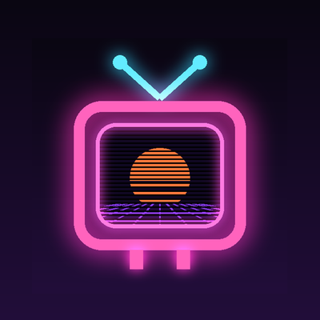

# Retrovision

**Play WoW like it's on an old TV, a 2004 PC monitor or a worn VHS tape.**

Retrovision is a World of Warcraft addon that lays a retro screen look over the game: scanlines, a phosphor mask, a monitor or TV frame, tape noise and VCR text. It's built from lightweight UI textures, with no shaders and no third-party tools.

## Features

- **11 presets**: Subtle, 80s TV, Arcade, Studio CRT, Amber, Green, VHS, 2004 CRT, Gaming CRT, Early LCD, Handheld, plus your own saved looks
- **Picture**: pixel-exact scanlines (2/3/4/6 px), interlacing, phosphor masks (stripe, dot, LCD, grid), tints, vignette, brightness, black level
- **Screen**: plain bezel or beige/black PC monitor frames, 4:3 mode, glass glare, early-LCD viewing angle and backlight bleed, degauss
- **Motion**: flicker, low-refresh shimmer, rolling hum bar, film grain, VHS tracking glitches, bottom noise strip
- **TV moments**: VCR text (PLAY / REC / clock), power on/off animation, channel-change static, low-health static, big-hit flicker
- **Auto rules**: different looks in combat, raids, dungeons, PvP or cities
- **Sharing**: copy your look as a short code that fits in chat
- **Reduce flashing**: one switch pauses every flicker, flash and glitch effect

## Install

Download the latest release zip (or from CurseForge) and extract the `Retrovision` folder into
`World of Warcraft/<your game folder>/Interface/AddOns/`.

## Use

- `/crt` or `/retro` opens the settings; `/crt help` lists all commands
- Minimap button: left-click settings, right-click overlay on/off, mouse wheel flips presets
- Key bindings: Game Menu > Options > Keybindings > AddOns > Retrovision

## Building from source

The addon itself is the `Retrovision` folder. The rest is tooling:

- `make_media.py`, `make_monitor.py`, `make_icon.py` generate the textures (Python 3 with Pillow and NumPy)
- `build.py` runs all of the above, then installs and zips. Edit the `DEST` path at the top for your own game folder.

## License

MIT, see [LICENSE](LICENSE). Bundled libraries keep their own licenses.
